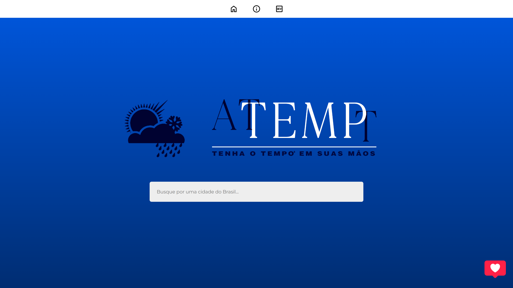

<h1 align="center">🌦️ atTEMPt — Tenha o Tempo em Suas Mãos</h1>

<p align="center">
  Previsão do tempo para qualquer cidade do Brasil, feita com Vue.js e consumo de APIs públicas.
</p>

<p align="center">
  
  
  
  
  
</p>

<p align="center">
  <a href="https://consumo-api-attempt.vercel.app/">
    
  </a>
</p>

<p align="center">
  
</p>

---

## 📋 Sobre o projeto

O **atTEMPt** é um site em que você pesquisa uma cidade brasileira e vê a previsão do tempo para os próximos dias, com detalhes como nascer e pôr do sol, umidade e precipitação. Também dá para ver fotos da cidade pesquisada.

O projeto foi criado para praticar **consumo de APIs** em uma aplicação Vue 3, juntando várias fontes de dados em uma interface simples e responsiva.

## ✨ Funcionalidades

- **🔎 Busca de cidades:** digite pelo menos 3 letras para ver as cidades do Brasil que combinam com a busca, com o estado e a UF de cada uma.
- **🌡️ Previsão do tempo:** temperatura atual e cards com a previsão de 10 dias, navegáveis pelas setas. Cada card mostra o dia da semana, a temperatura média, a condição do tempo e a mínima e a máxima.
- **🔄 Cards que giram:** ao clicar num card, ele vira e mostra a descrição do dia, o horário do nascer e do pôr do sol, a umidade e a precipitação.
- **🖼️ Galeria de fotos:** fotos da cidade em mosaico. Clique numa foto para ampliar e navegue pelas setas (ou pelas setas do teclado).
- **💘 Calculadora do Amor:** um "anúncio" divertido no canto da tela que calcula a compatibilidade entre dois nomes.
- **📱 Responsivo:** funciona no celular, no tablet e no computador, com o conteúdo limitado a 1200px de largura.

## 🔌 APIs utilizadas

| API | Para que serve |
| --- | --- |
| [IBGE — Localidades](https://servicodados.ibge.gov.br/api/docs/localidades) | Lista de municípios brasileiros, com estado e UF |
| [Visual Crossing Weather](https://www.visualcrossing.com/weather-api) | Clima atual e previsão dos próximos dias, em português |
| [Google Custom Search](https://developers.google.com/custom-search/v1/overview?hl=pt-br) | Busca de imagens da cidade pesquisada |
| [Love Calculator (RapidAPI)](https://rapidapi.com/ajith/api/love-calculator) | Porcentagem da Calculadora do Amor |

> **Observação:** a API da Calculadora do Amor saiu do ar. O site ainda tenta usá-la e, quando ela não responde, calcula o resultado localmente. O mesmo par de nomes sempre dá o mesmo resultado.

## 🚀 Como rodar localmente

Você precisa do [Node.js](https://nodejs.org/) instalado.

```bash
# 1. Clone o repositório
git clone https://github.com/SandySei/Consumo-API-Attempt.git

# 2. Entre na pasta
cd Consumo-API-Attempt

# 3. Instale as dependências
npm install

# 4. Rode o servidor de desenvolvimento
npm run dev
```

Depois abra o endereço que aparecer no terminal (normalmente `http://localhost:5173`).

Outros comandos:

| Comando | O que faz |
| --- | --- |
| `npm run build` | Gera a versão de produção na pasta `dist/` |
| `npm run preview` | Mostra localmente a versão gerada pelo build |

## 🗂️ Estrutura do projeto

```
src/
├── App.vue                 # Layout principal (navbar + páginas)
├── main.js                 # Ponto de entrada da aplicação
├── router/index.js         # Rotas
├── views/
│   ├── HomeView.vue        # Busca de cidades
│   ├── Detail.vue          # Previsão do tempo da cidade
│   ├── Info.vue            # Sobre o atTEMPt e a logo
│   └── Creators.vue        # Desenvolvedores e APIs usadas
├── components/
│   ├── search.vue          # Item da lista de cidades
│   ├── climaBox.vue        # Card de previsão (com flip)
│   ├── galeriaFotos.vue    # Galeria de fotos da cidade
│   ├── apiLove.vue         # Calculadora do Amor
│   └── loadingModal.vue    # Tela de carregamento
├── assets/                 # CSS global
├── icons/                  # Imagens dos cards de clima
├── imagens/ · logos/       # Imagens e logos do site
└── lottie/                 # Animações da Calculadora do Amor
```

## 👩‍💻 Desenvolvedores

<table>
  <tr>
    <td align="center">
      <a href="https://github.com/SandySei">
        <br />
        <b>Sandy Seixas</b>
      </a>
    </td>
    <td align="center">
      <a href="https://github.com/EduardoScarante">
        <br />
        <b>Eduardo Scarante</b>
      </a>
    </td>
  </tr>
</table>

## 📄 Licença

Este projeto está sob a licença descrita no arquivo [LICENSE](./LICENSE).

---

<p align="center">Obrigado por visitar este repositório! 💙</p>
